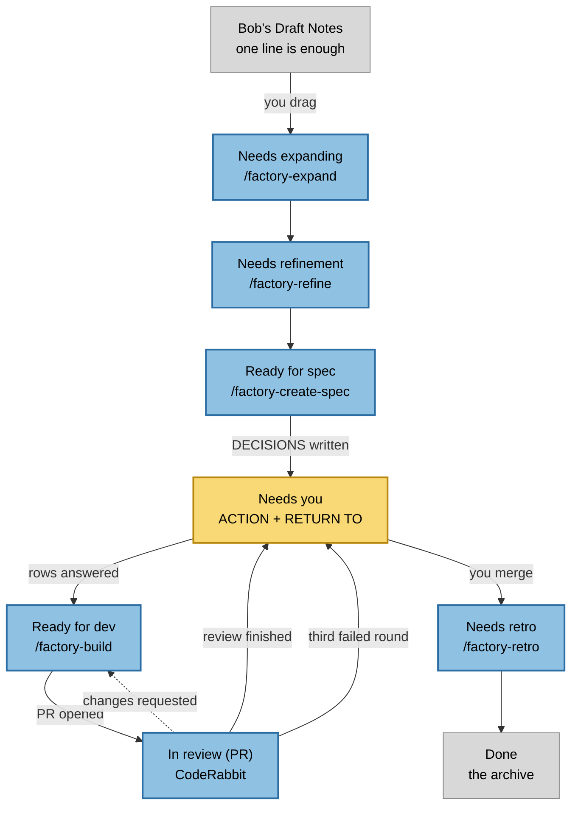

# Architecture

How a card moves through the factory, and what acts on it at each stop.

One column is yellow, and it is the only one you watch. Everything blue moves itself. Gray is where work starts and where it ends.

Every card in **Needs you** carries two lines at the top of its body: a bold **ACTION** saying what it wants, and a **RETURN TO** naming the column it goes back to. You never have to work out what a parked card needs.

This diagram is generated from `.factory/board.json` and the skills in `.claude/skills/`. Run `/factory-diagram` after changing a column or a command, and edit only the source, never the block below.

<!-- BEGIN board-diagram -->

<!-- END board-diagram -->

## What writes what

| Step | Who | Produces |
| --- | --- | --- |
| `/factory-expand` | agent | A one-liner read against the repo and written out |
| `/factory-refine` | agent | A real issue, labeled, one unit of work |
| `/factory-create-spec` | agent | `specs/<N>-<slug>/`, the brief in the issue body, the DECISIONS table, then a park in Needs you |
| You, in Needs you | you | Every DECISIONS row answered, and the card dragged to Ready for dev |
| `/factory-build` | agent | A branch, a commit, a PR that closes the issue |
| CodeRabbit, on the PR | agent | An approval, or a request for changes |
| `factory-reviewed.yml` | GitHub | A finished PR parked in Needs you, with an ACTION line naming the review state |
| `factory-changes-requested.yml` | GitHub | A reviewed-down card sent back to Ready for dev, or parked in Needs you on the third round |
| You, in Needs you | you | A merge |
| `factory-merged.yml` | GitHub | The card moved to Needs retro, no tokens spent |
| `/factory-retro` | agent | `docs/solutions/<N>-<slug>.md`, a rule in `AGENTS.md` if the run earned one, and Done |

`/factory-run` drives all of it on a loop. `/factory-refresh` runs at any point. It diffs the board against the last snapshot and offers to run whatever command the move handed over.

## The two rules the shape rests on

**You touch two columns.** You start work by dragging out of Bob's Draft Notes, and you unblock it in Needs you. Nothing else on the board is yours.

**A command that needs a decision parks the card rather than guessing.** It writes the ACTION line, moves the card to Needs you, and stops.

**Needs you is also the circuit breaker.** A card bounced between CodeRabbit and the builder three times parks there, because a fourth automated attempt at something three rounds could not fix is a loop rather than progress. The cap is `reviewRoundCap` in `.factory/board.json`.
