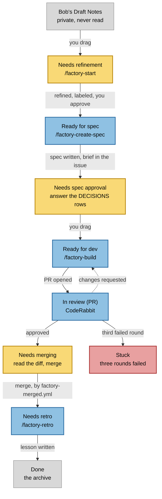

# Architecture

How a card moves through the factory, and what acts on it at each stop.

Yellow is a column waiting on you. Blue is a column waiting on a command or on CodeRabbit. Red is a card nothing will move until you decide. Gray is a column with nothing pending.

This diagram is generated from `.factory/board.json` and the skills in `.claude/skills/`. Run `/factory-diagram` after changing a column or a command, and edit only the source, never the block below.

<!-- BEGIN board-diagram -->

<!-- END board-diagram -->

## What writes what

| Step | Who | Produces |
| --- | --- | --- |
| `/factory-start` | you, with an agent | A real issue, labeled, one unit of work |
| `/factory-create-spec` | agent | `specs/<N>-<slug>/`, the brief in the issue body, the DECISIONS table |
| You, in the issue | you | Every DECISIONS row answered |
| `/factory-build` | agent | A branch, a commit, a PR that closes the issue |
| You, on the PR | you | A merge |
| `factory-merged.yml` | GitHub | The card moved to Needs retro, no tokens spent |
| `/factory-retro` | agent | `docs/solutions/<N>-<slug>.md`, and a rule in `AGENTS.md` if the run earned one |

`/factory-refresh` runs at any point. It diffs the board against the last snapshot and offers to run whatever command the move handed over.

## The two rules the shape rests on

**Only a human moves a card into an agent column.** That drag is the approval, and it is the only approval.

**Only an agent moves a card into a human column.** A command that finishes its work hands the card back rather than carrying it further.

**Stuck is the circuit breaker.** A card bounced between CodeRabbit and the builder three times stops there, because a fourth automated attempt at something two rounds could not fix is a loop rather than progress. No command reads that column.
